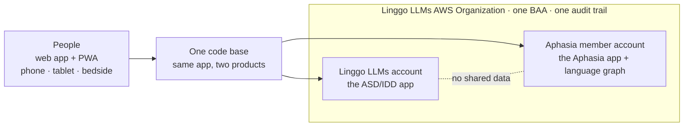
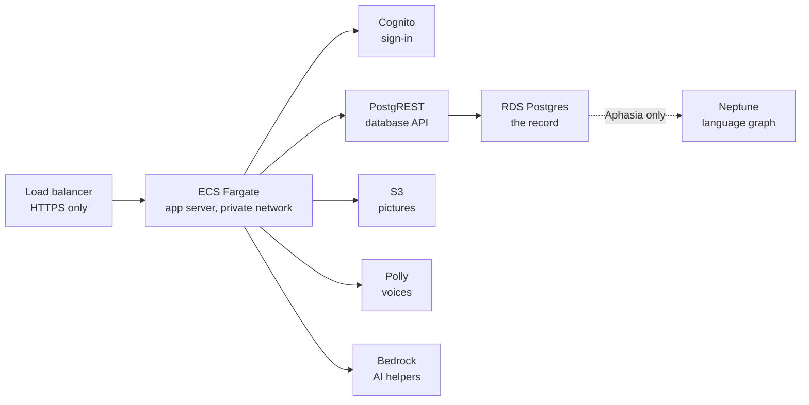

# Linggo LLMs

**AAC (augmentative and alternative communication) for people with little or no speech, built by a clinician on a HIPAA-covered AWS environment. Both products in beta since November 1, 2026.**

Linggo LLMs (Linggo USA Inc) gives children with autism or IDD and adults with aphasia, dementia or brain injury a way to speak: tap pictures, words or whole sentences and the device says them aloud, in the person's own language. Two products, one code base, five languages (English, Spanish, Arabic, Mandarin, French).

| Product | Who it is for | Repo | Status |
| --- | --- | --- | --- |
| **Linggo LLMs ASD/IDD** | Children and youth who need AAC; parents, teachers, therapists | `linggollms-asd-idd-webapp` (private) · [overview](https://github.com/linggollms/linggollms-docs/blob/main/apps/asd-idd.md) | Beta on AWS, web app + PWA (`webapp-dd.linggollms.com`); public demo boards |
| **Linggo LLMs Aphasia** | Adults after stroke, with dementia or brain injury; families, carers, SLPs | `linggollms-aphasia-webapp` (private) · [overview](https://github.com/linggollms/linggollms-docs/blob/main/apps/aphasia.md) | Beta on AWS, web app + PWA (`webapp-pwa.linggollms.com`) |

The product code is private because it runs in a HIPAA-covered environment and serves people's health information. Everything that can be public about it is in [`linggollms-docs`](https://github.com/linggollms/linggollms-docs): architecture, history, each repo's overview, and how the company runs. [Why the code is private.](https://github.com/linggollms/linggollms-docs/blob/main/why-the-code-is-private.md)

---

## Activity log

What was built and shipped, from the commit and pull request history. The new code base began on September 4, 2026 in the `mylinggo` account and moved into this organization in late October; its full history came with it.

### September 2026

| Date | Built or shipped |
| --- | --- |
| Sept 4 | First commit of the new code base. Every change on a branch and pull request from day one. |
| Sept 10–18 | The board: Language Tree, My Words, Keyboard with predictions, Quick Chat, caregiver Builder behind a PIN, a 3,593-word library, Symbol Lab, five languages, switch-access focus handling. |
| Sept 22–30 | The adult (aphasia) product specified and started. |

### October 2026

| Date | Built or shipped |
| --- | --- |
| Oct 15–17 | Whole stack moved to AWS: Cognito sign-in, PostgREST on RDS Postgres, S3, Bedrock, Polly. |
| Oct 21–22 | Linggo LLMs AWS Organization with an organization-wide BAA. Aphasia member account built from CloudFormation: CloudTrail, GuardDuty, AWS Config HIPAA conformance pack (130 checks), Security Hub, KMS, private encrypted RDS, Neptune graph (IAM-only, audited). |
| Oct 23 | **Aphasia beta live** at `webapp-pwa.linggollms.com`. PRD, TRD, architecture target, care-team architecture and decision records written. |
| Oct 24–29 | Phones and iPads: landscape layout, one tile size, phone keyboard. Speech on iPhones in any browser and in silent mode. Chosen voice saved for use offline; a tap speaks at once. Calm Lagoon theme for adults. Care-team design with one account for every role. Old Linggo error analysis. |
| Oct 30 | Privacy Policy and Terms of Use published at `policies.linggollms.com`. OpenAI removed from every service; ElevenLabs only with a person's own account in the aphasia app. |
| Oct 30–31 | Both apps running on ECS Fargate in private networks beside App Runner, with HTTPS-only load balancers, year-long logs and alarms. ASD/IDD: standalone sign-up, optional text messages at sign-up, the board fits phones, iPads and computers. |

### November 2026

| Date | Built or shipped |
| --- | --- |
| Nov 1 | **Both products in beta, including the ASD/IDD web app on AWS.** Both apps: build a new word from a category, and say when a category isn't on the board. |
| Nov 1–2 | Public demo: Lily's and Justin's communication boards with child voices, no sign-in, at `demo-lily.linggollms.com` and `demo-justin.linggollms.com`; embeddable on `linggollms.com` only. |
| Nov 2 | Architecture page for each app (`docs/architecture.md`): AWS, BAA boundary, security controls, accessibility, gaps before real patients. |

Commits on `main` as of November 2, 2026: 1,534 in `linggollms-asd-idd-webapp` (since September 4, including the `mylinggo` period) and 269 in `linggollms-aphasia-webapp` (since September 22). Until mid-October, commits reached GitHub through a sync tool, so many carry its bot label; the code was written by the founder with Claude Code.

---

## What's in here

| Repo | Visibility | What it is |
| --- | --- | --- |
| [`linggollms-docs`](https://github.com/linggollms/linggollms-docs) | Public | Platform documentation: architecture, history, repo overviews, how the company runs, the agents. Start here. |
| `linggollms-aphasia-webapp` | Private | The adult AAC board. TanStack Start + React 19, Drizzle ORM, Bun. Its `docs/` folder is the platform's documentation of record. |
| `linggollms-asd-idd-webapp` | Private | The children's AAC board. Same code base, different content, voices and tone. |
| `linggollms-design-system` | Private | Brand foundations: logo, palette, type. |
| `website-refresh-studio` | Private | The public website. |
| `linggollms-animation-studio` | Private | In-house animation studio for training videos that reflect the real lives of people with disabilities, because existing training video is sanitized and AI generators can't simulate scenarios they've never seen. A 58-character cast, hand-drawn and mesh rigs, real AAC screens, five-language narration. Early prototype. |
| `linggollms-ops` | Private | The Command Center robot: a daily GitHub Action that reads GitHub, Notion and AWS (read-only) and writes live status back into the operating system. |
| `socialmedia_agent` | Private | How Linggo LLMs plans and posts to social media, through a self-hosted scheduler. |

Nothing in these repositories contains protected health information. Documentation never records account IDs, resource IDs, IP addresses or anything identifying a person who uses the app.

---

## Architecture

Inside each account, the same pattern:

Each app has its own sign-in pool, database, buckets and keys; health information never mixes between them. Postgres is the record of everything. Row-level security in Postgres decides what each signed-in person can read, using the token Cognito gives them. Neptune sits beside Postgres and links a person to what they said, to the words and pictures they used, to what each word means *for them*: first the person's own graph, later an anonymous shared graph from people who opt in. Only HIPAA-eligible AWS services touch what a person says; any outside voice or AI service needs a BAA or stays off.

**Where it stands (November 2, 2026).** Both apps have their Fargate copy built in a private network; App Runner still serves traffic until the DNS switch, then is paused. Next: the database API moves off App Runner into the private network, the ASD/IDD database is rebuilt inside its private network from the same CloudFormation kit as the aphasia app, then Multi-AZ, a second NAT and AWS WAF before real patients. Each repo's `docs/architecture.md` has the full picture and the gap list; the public summary is [here](https://github.com/linggollms/linggollms-docs/blob/main/platform/architecture.md).

In progress: an AI assistant inside each app for questions and support, on Bedrock in the same account; for Aphasia, PHI intake by email (every message carries a confidentiality addendum) and by secure upload in the app, into the account's encrypted storage, processed inside the boundary. After the beta: iOS, Google Play and Amazon Appstore apps from the same code base.

---

## How we build

- **Clinician-led.** The founder is a Board Certified Behavior Analyst (M.ADS, BCBA) with years of AAC practice. Product decisions are logged with dates and reasons (`docs/logic/decisions.md`), and an evidence-review agent checks each release against the AAC research base for the target population (minimal to no speech; autism/IDD; acquired disorders).
- **AI-native.** The founder builds with Claude Code; agents run research, competitor tracking, ops checks and social. The company runs on an AI-native operating system ([COM Systems](https://github.com/linggollms/linggollms-docs/blob/main/com-systems.md)) in Notion, with humans making every decision that touches a person's data. [The agents.](https://github.com/linggollms/linggollms-docs/blob/main/agents.md)
- **Accessible by default.** Screens are designed and checked against WCAG 2.2 AA, with keyboard and switch access, screen readers and five languages. [Accessibility Statement.](https://www.linggollms.com/accessibility)
- **Plain words.** Documentation is written for clinicians, families and partners, not just developers.

**Contact:** Ling Ly Tan, Founder and CEO · admin@linggollms.com · [linggollms.com](https://linggollms.com)
