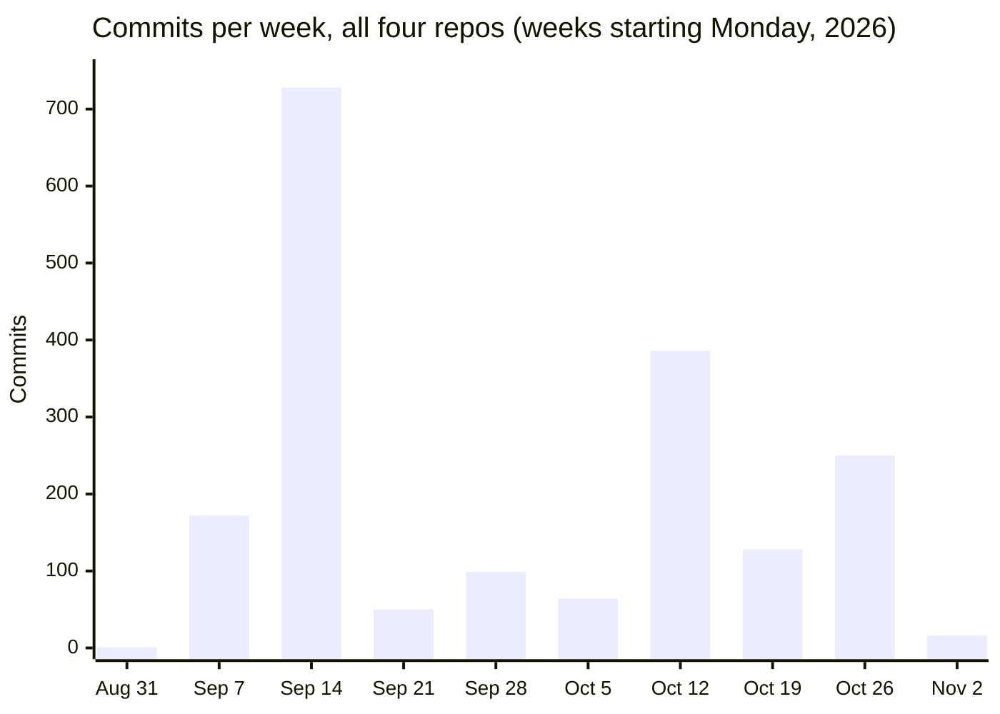
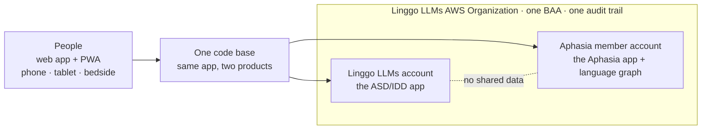
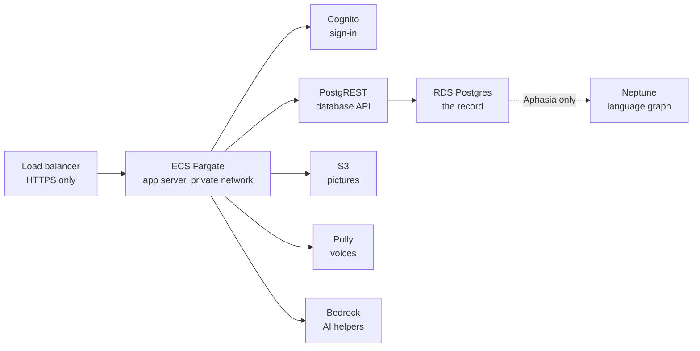

# Linggo LLMs

**AAC (augmentative and alternative communication) for people with little or no speech, built by a clinician on a HIPAA-covered AWS environment. Both products in beta since November 1, 2026.**

Linggo LLMs (Linggo USA Inc) gives children with autism or IDD and adults with aphasia, dementia or brain injury a way to speak: tap pictures, words or whole sentences and the device says them aloud, in the person's own language. Two products, one code base, five languages (English, Spanish, Arabic, Mandarin, French).

| Product | Who it is for | Repo | Status |
| --- | --- | --- | --- |
| **Linggo LLMs ASD/IDD** | Children and youth who need AAC; parents, teachers, therapists | `linggollms-asd-idd-webapp` (private) · [overview](https://github.com/linggollms/linggollms-docs/blob/main/apps/asd-idd.md) | Beta on AWS, web app + PWA (`webapp-dd.linggollms.com`); public demo boards |
| **Linggo LLMs Aphasia** | Adults after stroke, with dementia or brain injury; families, carers, SLPs | `linggollms-aphasia-webapp` (private) · [overview](https://github.com/linggollms/linggollms-docs/blob/main/apps/aphasia.md) | Beta on AWS, web app + PWA (`webapp-pwa.linggollms.com`) |

The product code is private because it runs in a HIPAA-covered environment and serves people's health information. Everything that can be public about it is in [`linggollms-docs`](https://github.com/linggollms/linggollms-docs): architecture, history, each repo's overview, and how the company runs. [Why the code is private.](https://github.com/linggollms/linggollms-docs/blob/main/why-the-code-is-private.md)

---

## Activity log

What was built and shipped, from the commit history of every repo in this organization (about 2,000 unique commits as of November 2, 2026). The code was written by the founder with Claude Code; it began in the `mylinggo` account on September 4, 2026 and moved here with its full history.

### Before September 2026

Linggo was founded by a Board Certified Behavior Analyst with years of AAC practice. The original Linggo platform, built from 2020 by a contracted engineering team, served families and clinicians from its first beta in 2021, with about 2,900 registered learners and professionals. In September 2026 its graph database cluster ran into trouble: reads slowed and writes stopped. The lessons were documented, and the platform was rebuilt from new code, in a new company (Linggo USA Inc, doing business as Linggo LLMs), on an environment built for health information from the first day.

### September to November 2026

| When | Area | What was built or shipped |
| --- | --- | --- |
| Sept 4–18 | App, Database | New code base started (every change on a branch and pull request). The board: Language Tree, My Words, Keyboard with predictions, Quick Chat, caregiver Builder behind a PIN, a 3,593-word library with photos and emoji, Symbol Lab, five languages, switch-access focus. First database migrations; numbered product decision log |
| Sept 22–30 | App, Security | Aphasia product specified and started. Hashed PINs, admin-only clinician links, email-only sign-in |
| Oct 4–15 | App, Database | Offline use (board, pictures and chosen voice), opt-in character voices, Symbol Lab composition, My Topics builder, Scene Chat with AI suggestions, Lily's demo board, an accessibility QA pass, limits on codes and PIN tries, numbered database updates |
| **Oct 16** | **Architecture** | **Move to AWS:** Cognito sign-in, PostgREST on RDS Postgres, S3, Polly voices, Bedrock AI helpers (Nova; Claude when unlocked) |
| Oct 17–22 | Architecture, App | Aphasia app on AWS in its own member account under an organization-wide BAA, built from CloudFormation: CloudTrail, GuardDuty, AWS Config HIPAA pack (130 checks), Security Hub, KMS, private encrypted RDS, Neptune. Adult starter topics, wallet card, What's new. OpenAI removed. Architecture target and care-team design |
| **Oct 23** | **App** | **Aphasia beta live** at `webapp-pwa.linggollms.com`. Phone and iPad layouts. PRD and TRD |
| Oct 28–31 | Architecture, Docs | Both apps on ECS Fargate in private networks behind HTTPS-only load balancers, with alarms. Two-apps design and AWS account kit. Privacy Policy and Terms of Use published. ASD/IDD sign-up with optional text messages |
| **Nov 1–2** | **App, Docs** | **Both products in beta, including the ASD/IDD web app on AWS** (`webapp-dd.linggollms.com`). Public demo boards (Lily, Justin). Architecture page for each app; Accessibility Statement and Privacy Policy list both apps at their AWS addresses |

### Development record

As of November 2, 2026, from each repo's git history.

| Repo | Commits | First – last | Merged pull requests | Database changes (SQL migrations) | Tests | Docs (`docs/*.md`) |
| --- | --- | --- | --- | --- | --- | --- |
| `linggollms-asd-idd-webapp` | 1,537 | Sept 4 – Nov 2 | 14 in this organization; earlier ones in the `mylinggo` repo | 114: 65 on the first host's Postgres (Sept 11–30), 49 on AWS RDS (`0000` to `0048_sms_contacts`) | 71 | 12 |
| `linggollms-aphasia-webapp` | 271 | Sept 22 – Nov 2 | 46 | 139: the same 65, plus 74 on AWS RDS (`0000` to `0073_lagoon_default_theme`) | 70 | 26 |
| `website-refresh-studio` | 49 | Oct 16 – Nov 1 | | | | |
| `linggollms-animation-studio` | 37 | Oct 29 – Oct 30 | | | | |

Across the whole organization: **about 2,000 unique commits** on all branches (1,906 on `main` plus 98 on other branches; feature branches of the Aphasia app hold 50 of those). The smaller repos (ops, design system, docs, this profile, social, fundraising) add 12 on `main`. Pull requests from the `mylinggo` period are not counted, because that repository is no longer reachable; its commits are.

Every database change is a numbered SQL file, rehearsed on a local Postgres before it is deployed; on AWS a build job inside the private network applies only the files it has not recorded.

Until mid-October, commits reached GitHub through a hosting tool's sync, so the September bars show when work arrived rather than exact build days.

### Notable doc changes

| Date | Document | What changed |
| --- | --- | --- |
| Sept 16–17 | `docs/logic/decisions.md` | Numbered product decision log started, with dates and reasons |
| Oct 13–15 | Roadmap and AWS HIPAA plan | Product and AI roadmap; the plan for a HIPAA-controlled AWS environment |
| Oct 20 | `docs/architecture-target.md` | Where the platform is heading: lifelong account, store apps, Neptune, FHIR and appSphere |
| Oct 22 | `docs/care-team-architecture.md` | Companions, coaches, admins, consent, access log |
| Oct 23–24 | `docs/prd.md`, `docs/trd.md` | Product and technical requirements |
| Oct 28 | `docs/two-apps.md`, `docs/aws-account-kit.md` | How the two apps differ and sit on AWS; the CloudFormation kit for the ASD/IDD rebuild |
| Oct 28 | Repo rules | GitHub is the origin for technical docs; Notion mirrors it |
| Oct 29–30 | Privacy Policy, Terms of Use, Health Data Privacy Policy | Drafted, then published |
| Oct 30–31 | `docs/fargate.md` (both apps) | The move to ECS Fargate, switch-over and rollback |
| Oct 31 | Old Linggo error analysis | September 1 to October 30, 2026 |
| Nov 2 | `docs/architecture.md` (both apps) | One page per app: AWS, BAA boundary, security controls, accessibility, gaps before real patients |
| Nov 2 | Accessibility Statement, Privacy Policy | Both web apps listed at their AWS addresses |
| Nov 2 | This profile, `linggollms-docs` | Activity log in place of the earlier narrative; current architecture; policies page; accessibility agent |

---

## What's in here

| Repo | Visibility | What it is |
| --- | --- | --- |
| [`linggollms-docs`](https://github.com/linggollms/linggollms-docs) | Public | Platform documentation: architecture, history, repo overviews, how the company runs, the agents. Start here. |
| `linggollms-aphasia-webapp` | Private | The adult AAC board. TanStack Start + React 19, Drizzle ORM, Bun. Its `docs/` folder is the platform's documentation of record. |
| `linggollms-asd-idd-webapp` | Private | The children's AAC board. Same code base, different content, voices and tone. |
| `linggollms-design-system` | Private | Brand foundations: logo, palette, type. |
| `website-refresh-studio` | Private | The public website. |
| `linggollms-animation-studio` | Private | In-house animation studio for training videos that reflect the real lives of people with disabilities, because existing training video is sanitized and AI generators can't simulate scenarios they've never seen. A 58-character cast, hand-drawn and mesh rigs, real AAC screens, five-language narration. Early prototype. |
| `linggollms-ops` | Private | The Command Center robot: a daily GitHub Action that reads GitHub, Notion and AWS (read-only) and writes live status back into the operating system. |
| `socialmedia_agent` | Private | How Linggo LLMs plans and posts to social media, through a self-hosted scheduler. |

Nothing in these repositories contains protected health information. Documentation never records account IDs, resource IDs, IP addresses or anything identifying a person who uses the app.

---

## Architecture

Inside each account, the same pattern:

Each app has its own sign-in pool, database, buckets and keys; health information never mixes between them. Postgres is the record of everything. Row-level security in Postgres decides what each signed-in person can read, using the token Cognito gives them. Neptune sits beside Postgres and links a person to what they said, to the words and pictures they used, to what each word means *for them*: first the person's own graph, later an anonymous shared graph from people who opt in. Only HIPAA-eligible AWS services touch what a person says; any outside voice or AI service needs a BAA or stays off.

**Where it stands (November 2, 2026).** Both apps have their Fargate copy built in a private network; App Runner still serves traffic until the DNS switch, then is paused. Next: the database API moves off App Runner into the private network, the ASD/IDD database is rebuilt inside its private network from the same CloudFormation kit as the aphasia app, then Multi-AZ, a second NAT and AWS WAF before real patients. Each repo's `docs/architecture.md` has the full picture and the gap list; the public summary is [here](https://github.com/linggollms/linggollms-docs/blob/main/platform/architecture.md).

In progress: an AI assistant inside each app for questions and support, on Bedrock in the same account; for Aphasia, PHI intake by email (every message carries a confidentiality addendum) and by secure upload in the app, into the account's encrypted storage, processed inside the boundary. After the beta: iOS, Google Play and Amazon Appstore apps from the same code base.

---

## How we build

- **Clinician-led.** The founder is a Board Certified Behavior Analyst (M.ADS, BCBA) with years of AAC practice. Product decisions are logged with dates and reasons (`docs/logic/decisions.md`), and an evidence-review agent checks each release against the AAC research base for the target population (minimal to no speech; autism/IDD; acquired disorders).
- **AI-native.** The founder builds with Claude Code; agents run research, competitor tracking, ops checks and social. The company runs on an AI-native operating system ([COM Systems](https://github.com/linggollms/linggollms-docs/blob/main/com-systems.md)) in Notion, with humans making every decision that touches a person's data. [The agents.](https://github.com/linggollms/linggollms-docs/blob/main/agents.md)
- **Accessible by default.** Screens are designed and checked against WCAG 2.2 AA, with keyboard and switch access, screen readers and five languages. [Accessibility Statement.](https://www.linggollms.com/accessibility)
- **Plain words.** Documentation is written for clinicians, families and partners, not just developers.

**Contact:** Ling Ly Tan, Founder and CEO · ling@linggollms.com · [linggollms.com](https://linggollms.com)
