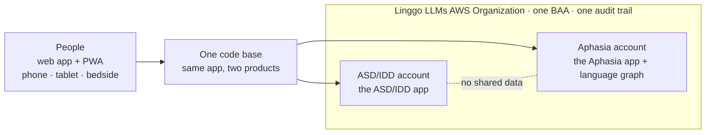
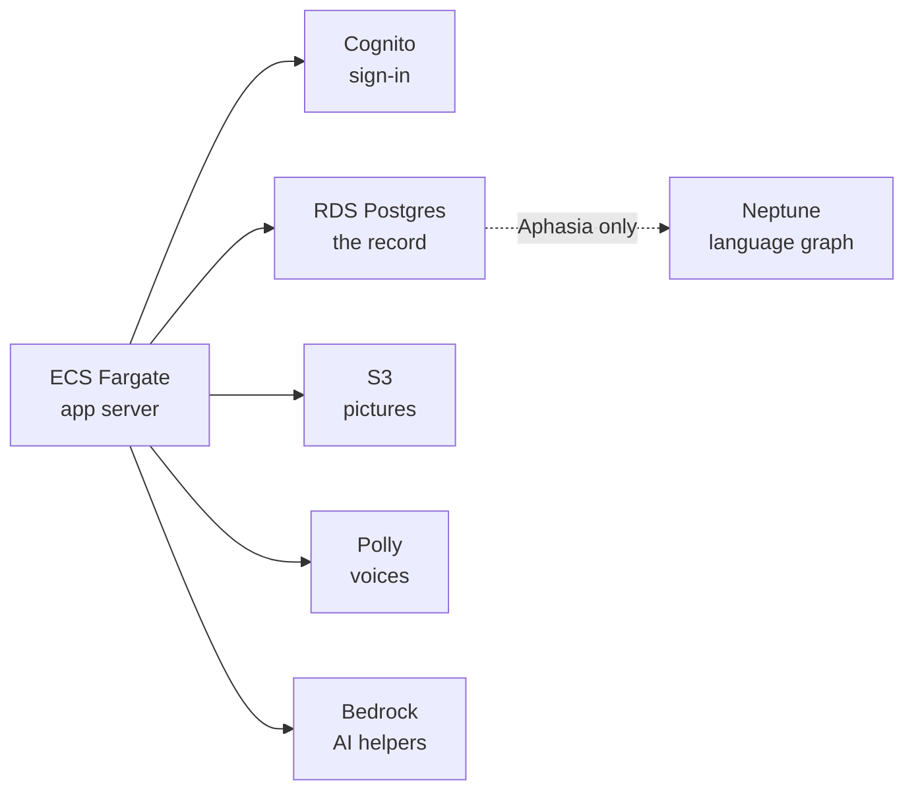

# Linggo LLMs

**AAC (augmentative and alternative communication) for people with little or no speech — rebuilt from the first line of code in ten weeks, by a clinician, in a HIPAA-covered AWS environment. Beta launched November 1, 2026.**

Linggo LLMs (Linggo USA Inc) gives children with autism or IDD and adults with aphasia, dementia or brain injury a way to speak: tap pictures, words or whole sentences and the device says them aloud, in the person's own language. Two products, one code base, five languages (English, Spanish, Arabic, Mandarin, French).

| Product | Who it is for | Repo | Status |
| --- | --- | --- | --- |
| **Linggo LLMs ASD/IDD** | Children and youth who need AAC; parents, teachers, therapists | `linggollms-asd-idd-webapp` (private) · [overview](https://github.com/linggollms/linggollms-docs/blob/main/apps/asd-idd.md) | Beta, web app + PWA |
| **Linggo LLMs Aphasia** | Adults after stroke, with dementia or brain injury; families, carers, SLPs | `linggollms-aphasia-webapp` (private) · [overview](https://github.com/linggollms/linggollms-docs/blob/main/apps/aphasia.md) | Beta, web app + PWA |

The product code is private because it runs in a HIPAA-covered environment and serves people's health information. Everything that can be public about it is in [`linggollms-docs`](https://github.com/linggollms/linggollms-docs): architecture, history, each repo's overview, and how the company runs. [Why the code is private.](https://github.com/linggollms/linggollms-docs/blob/main/why-the-code-is-private.md)

---

## The ten weeks

Linggo was founded and shipped its first working beta during COVID. The original product (Python Serverless on AWS Lambda, DynamoDB, a self-managed Neo4j graph, a Flutter front end) served roughly 2,900 registered learners and professionals, but the codebase had gone quiet: the last meaningful commits were September 2024. Users around the world depended on an app nobody was actively building.

In early September 2026 the Neo4j cluster behind it went down. Reads degraded, writes stopped, and the people who relied on Linggo to speak lost their voices. The developer was unreachable. The founder, a BCBA and clinician who had never opened a terminal, fixed it herself.

Then she decided the company would not be at anyone's mercy again.

| | |
| --- | --- |
| **Sept 4** | First commit of the new codebase. The founder in the terminal with Claude Code from day one; every change on a branch and pull request. |
| **Sept 10–18** | The heavy build: ~940 commits in two weeks. Language Tree, My Words, Keyboard with predictions, Quick Chat, caregiver Builder behind a PIN, a 3,593-word library, Symbol Lab, five languages, switch-access focus handling. |
| **Sept 30** | The adult (aphasia) product is specified and started. |
| **Oct 15–17** | Decision: the managed database the first version ran on could not meet HIPAA requirements, and migrating users' language graphs later would only get harder. The whole stack moves to AWS: Cognito, PostgREST on RDS Postgres, S3, Bedrock, Polly. The Lovable hosting/sync layer is removed. |
| **Oct 21–22** | The aphasia product gets its own AWS member account inside a Linggo LLMs AWS Organization: organization-wide BAA, CloudTrail, GuardDuty, AWS Config with the HIPAA conformance pack, Security Hub, built from CloudFormation. Amazon Neptune graph built, IAM-only, audited. |
| **Oct 23** | Aphasia beta live at webapp-pwa.linggollms.com. PRD, TRD, architecture target, care-team architecture and 15 ADRs written. |
| **Nov 1** | Both products in beta. |

**What that produced, by a solo founder in 58 days:** two products in beta on a HIPAA-covered AWS environment built entirely from code; 130 automated HIPAA checks (AWS Config conformance pack) and Security Hub running in the account that holds health data; audit logging on every data access and every graph query; 15 architecture decision records and a plain-language change log; an evidence review against the AAC research base before release; a database schema rebuilt from scratch and rehearsed locally before every deploy; a container security scan that found seven issues, all in the Debian base image and none in Linggo's own code.

Supporting numbers: 2,049 unique commits and 179 merged pull requests across the organization, Sept 4 – Nov 1, 2026, by the founder and Claude Code. (Until mid-October, commits reached GitHub through a Lovable sync, so about 1,100 carry its bot label; the code was written in Claude Code.)

---

## What's in here

| Repo | Visibility | What it is |
| --- | --- | --- |
| [`linggollms-docs`](https://github.com/linggollms/linggollms-docs) | Public | Platform documentation: architecture, history, repo overviews, how the company runs, the agents. Start here. |
| `linggollms-aphasia-webapp` | Private | The adult AAC board. TanStack Start + React 19, Drizzle ORM, Bun. Its `docs/` folder is the platform's documentation of record. |
| `linggollms-asd-idd-webapp` | Private | The children's AAC board. Same code base, different content, voices and tone. |
| `linggollms-design-system` | Private | Brand foundations: logo, palette, type. |
| `website-refresh-studio` | Private | The public website. |
| `linggollms-animation-studio` | Private | In-house animation studio for training videos that reflect the real lives of people with disabilities, because existing training video is sanitized and AI generators can't simulate scenarios they've never seen. A 58-character cast, hand-drawn and mesh rigs, real AAC screens, five-language narration. Early prototype. |
| `linggollms-ops` | Private | The Command Center robot: a daily GitHub Action that reads GitHub, Notion and AWS (read-only) and writes live status back into the operating system. |
| `socialmedia_agent` | Private | How Linggo LLMs plans and posts to social media, through a self-hosted scheduler. |

Nothing in these repositories contains protected health information. Documentation never records account IDs, resource IDs, IP addresses or anything identifying a person who uses the app.

---

## Architecture

Inside each account, the same pattern:

Both apps run on ECS Fargate inside each account's private network. Postgres is the record of everything. Neptune sits beside it and links a person to what they said, to the words and pictures they used, to what each word means *for them*. First the person's own graph; later, an anonymous shared graph from people who opt in. Only HIPAA-eligible AWS services touch what a person says; any outside voice or AI service needs a BAA or stays off.

In progress: an AI assistant inside each app for questions and support, on Bedrock in the same account; for Aphasia, PHI intake by email (every message carries a confidentiality addendum) and by secure upload in the app, into the account's encrypted storage, processed inside the boundary. After the beta: iOS, Google Play and Amazon Appstore apps from the same code base, offered first to people who have had good experiences with Linggo and want to explore the new AI features. The full picture, both apps side by side: [architecture](https://github.com/linggollms/linggollms-docs/blob/main/platform/architecture.md).

---

## Patent

US Patent Application 18/452,469, *Assistive Communication Using Word Trees*: predicting what a person is trying to say from a graph of their own language, with the clinician and family in the loop to train it. Prosecution is ongoing; the Neptune graph above is where it lives in the product.

---

## How we build

- **Clinician-led.** The founder is a Board Certified Behavior Analyst (M.ADS, BCBA) with years of AAC practice. Product decisions are logged with dates and reasons (`docs/logic/decisions.md`), and an evidence-review agent checks each release against the AAC research base for the target population (minimal to no speech; autism/IDD; acquired disorders).
- **AI-native.** The founder builds with Claude Code; agents run research, competitor tracking, ops checks and social. The company runs on an AI-native operating system ([COM Systems](https://github.com/linggollms/linggollms-docs/blob/main/com-systems.md)) in Notion, with humans making every decision that touches a person's data. [The agents.](https://github.com/linggollms/linggollms-docs/blob/main/agents.md)
- **Plain words.** Documentation is written for clinicians, families and partners, not just developers.

**Contact:** Ling Ly Tan, Founder and CEO · admin@linggollms.com · [linggollms.com](https://linggollms.com)
