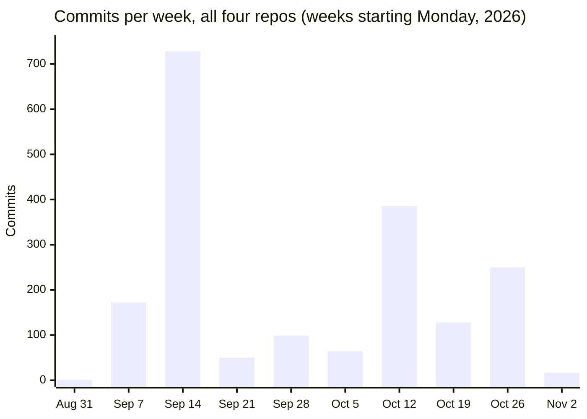
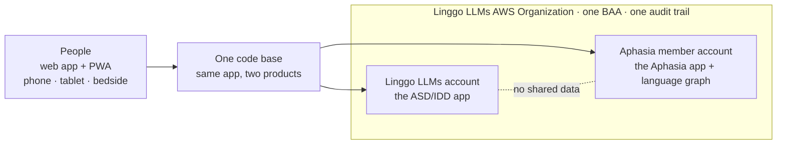
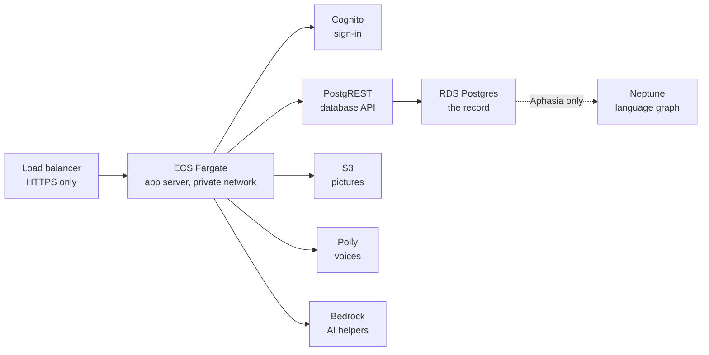

# Linggo LLMs

**AAC (augmentative and alternative communication) for people with little or no speech, built by a clinician on a HIPAA-covered AWS environment. Both products in beta since November 1, 2026.**

Linggo LLMs (Linggo USA Inc) gives children with autism or IDD and adults with aphasia, dementia or brain injury a way to speak: tap pictures, words or whole sentences and the device says them aloud, in the person's own language. Two products, one code base, five languages (English, Spanish, Arabic, Mandarin, French).

| Product | Who it is for | Repo | Status |
| --- | --- | --- | --- |
| **Linggo LLMs ASD/IDD** | Children and youth who need AAC; parents, teachers, therapists | `linggollms-asd-idd-webapp` (private) · [overview](https://github.com/linggollms/linggollms-docs/blob/main/apps/asd-idd.md) | Beta on AWS, web app + PWA (`webapp-dd.linggollms.com`); public demo boards |
| **Linggo LLMs Aphasia** | Adults after stroke, with dementia or brain injury; families, carers, SLPs | `linggollms-aphasia-webapp` (private) · [overview](https://github.com/linggollms/linggollms-docs/blob/main/apps/aphasia.md) | Beta on AWS, web app + PWA (`webapp-pwa.linggollms.com`) |

The product code is private because it runs in a HIPAA-covered environment and serves people's health information. Everything that can be public about it is in [`linggollms-docs`](https://github.com/linggollms/linggollms-docs): architecture, history, each repo's overview, and how the company runs. [Why the code is private.](https://github.com/linggollms/linggollms-docs/blob/main/why-the-code-is-private.md)

---

## Activity log

What was built, changed and shipped, in date order, from the commit history of `linggollms-asd-idd-webapp`, `linggollms-aphasia-webapp`, `website-refresh-studio` and `linggollms-animation-studio` (1,894 commits, all read on November 2, 2026). The new code base began on September 4, 2026 in the `mylinggo` account and moved into this organization with its full history. Until mid-October, commits reached GitHub through a hosting tool's sync, so about 1,000 carry its bot label and arrive in bursts; dates inside those bursts are approximate. The code was written by the founder with Claude Code.

### Before 2026: the original Linggo

| When | What |
| --- | --- |
| 2019 | Development began |
| 2021 | First beta, during COVID: a Python Serverless backend on AWS Lambda and API Gateway, Cognito, DynamoDB, S3, a self-managed Neo4j graph on EC2, and a Flutter front end, built by a contracted team. About 2,900 registered learners and professionals |
| Sept 2024 | Last meaningful commits to that code base (held by the original Canadian entity, not in this organization) |
| Early Sept 2026 | The Neo4j cluster failed; reads degraded and writes stopped. The incident review listed what the new platform must not repeat: public access and exposed ports, credentials in repository history, no monitoring, untested backups |

### September 2026

| Date | Area | What changed |
| --- | --- | --- |
| Sept 4 | App | ASD/IDD code base started from a TanStack Start template; every change on a branch and pull request |
| Sept 10–11 | App | Accounts, boards, the Language Tree flow; Spanish added to four languages |
| Sept 15 | App | Linggo word library, photos and emoji pictures, the Dashboard with Builder and Settings, Keyboard first |
| Sept 15 | Database | Word model v2 migration |
| Sept 15 | Security | Hashed PIN functions; admin-only clinician links |
| Sept 16 | App | Full-screen Quick Chat; default voice; demo voice and sign-in fixes |
| Sept 16–18 | Database | Library and word-forms SQL, skin-tone and default-character migrations, four emoji migrations |
| Sept 16–17 | Docs | Numbered product decision log started (`docs/logic/decisions.md`) |
| Sept 17–18 | App | Symbol Lab as its own Dashboard tool; emoji for 710 more words; 116 new words |
| Sept 22 | App | Aphasia repo started from the same template |
| Sept 25 | Architecture | Neptune export tool added |
| Sept 28 | Security | Sign-in by email only (phone and WhatsApp hidden); password-reset link fixed |
| Sept 29 | Database | PIN functions fixed for pgcrypto on the live database, with a server fallback |
| Sept 30 | App | 29-phrase Quick Chat; Aphasia onboarding screens |

### October 2026

| Date | Area | What changed |
| --- | --- | --- |
| Oct 4–7 | App | ElevenLabs voices in the voice picker; Symbol Lab composes symbols from several emoji, suggests word types and forms, catches duplicates |
| Oct 6 | App | Offline: the board, pictures and chosen voice work without a connection |
| Oct 11–12 | App | Accessibility and usability fixes from a QA pass; My Topics builder with columns and folders |
| Oct 13 | Database | Numbered updates 0021 and 0023; new boards start with starter topics |
| Oct 13–14 | App | Lily's demo board with her voice; Scene Chat with AI suggestions for hotspots, phrases and topics |
| Oct 14 | Security | Limits on sign-in codes, PIN tries and backup codes |
| Oct 14–15 | Database | Update 0027; a test that database updates are dated in order; child starter topics; 0036 renumbered after the host's sync branch |
| **Oct 16** | **Architecture** | **Move to AWS:** sign-in on Cognito, data through PostgREST on RDS Postgres instead of the first host's database (moved accounts keep their old id through the token), S3, App Runner build |
| Oct 16 | App | Natural voices from Amazon Polly instead of OpenAI; AI helpers on Bedrock (Nova, Claude when unlocked); the board opens from its saved copy at once |
| Oct 17 | Database | Aphasia: database build Lambda; its own numbered updates from 0056 on |
| Oct 17–20 | App | Aphasia: Talking With Me and Speaking Up topics, What's new, Show/Hide on password and PIN, wallet card with QR code, My Day sentence starters |
| Oct 20–22 | Docs | Architecture target; care-team architecture; evidence review of the v1 beta |
| **Oct 21** | **Architecture** | **Aphasia in its own AWS member account**, under an organization-wide BAA: CloudFormation, CloudTrail, GuardDuty, AWS Config HIPAA pack (130 checks), Security Hub, KMS, private encrypted RDS, Neptune with an audit log; deploys from `main` |
| Oct 22 | Security | ElevenLabs off by default; OpenAI removed from voices; "Linggo LLMs" name in all five languages |
| Oct 23 | App | **Aphasia beta live** at `webapp-pwa.linggollms.com`; phone and iPad layouts (landscape, one tile size, phone keyboard) |
| Oct 23–24 | Docs | PRD and TRD |
| Oct 28 | Docs | Two-apps design, AWS account kit, target design, consent once at first invitation; GitHub as the origin for technical docs |
| Oct 28 | App | ASD/IDD: the same phone and iPad layouts |
| Oct 29 | App | Chosen voice kept for offline use; sign-up stands on its own |
| Oct 29 | Website | Visitor AI helper off; Health Data Privacy Policy page |
| Oct 29–30 | Studio | Animation studio: pose library, character frames, first lesson, ADR 0001 |
| Oct 30 | Security | Aphasia: ElevenLabs only with a person's own account. Privacy Policy and Terms of Use published at policies.linggollms.com |
| **Oct 30–31** | **Architecture** | **Both apps on ECS Fargate** in private networks behind HTTPS-only load balancers, logs kept a year, alarms; App Runner kept as the way back. Fargate docs for both apps |
| Oct 30–31 | App | ASD/IDD: optional text messages at sign-up; create-account links open the form |

### November 2026

| Date | Area | What changed |
| --- | --- | --- |
| Nov 1 | App | **Both products in beta**, including the ASD/IDD web app on AWS (`webapp-dd.linggollms.com`). Demo: Lily and Justin's boards, the real Dashboard with no PIN, never leads to sign-in; demo-lily and demo-justin addresses |
| Nov 1 | Website | Policies section; sign-in and sign-up links point to the ASD/IDD app on AWS |
| Nov 2 | Docs | Architecture page in both apps (AWS, BAA boundary, security controls, accessibility, gaps before real patients); Accessibility Statement and Privacy Policy list both apps at their AWS addresses |
| Nov 2 | Security | Leftover `.env` from the first host removed from the ASD/IDD repo and blocked by `.gitignore` |

### Development record

As of November 2, 2026, from each repo's git history.

| Repo | Commits | First – last | Merged pull requests | Database changes (SQL migrations) | Tests | Docs (`docs/*.md`) |
| --- | --- | --- | --- | --- | --- | --- |
| `linggollms-asd-idd-webapp` | 1,537 | Sept 4 – Nov 2 | 14 in this organization; earlier ones in the `mylinggo` repo | 114: 65 on the first host's Postgres (Sept 11–30), 49 on AWS RDS (`0000` to `0048_sms_contacts`) | 71 | 12 |
| `linggollms-aphasia-webapp` | 271 | Sept 22 – Nov 2 | 46 | 139: the same 65, plus 74 on AWS RDS (`0000` to `0073_lagoon_default_theme`) | 70 | 26 |
| `website-refresh-studio` | 49 | Oct 16 – Nov 1 | | | | |
| `linggollms-animation-studio` | 37 | Oct 29 – Oct 30 | | | | |

Every database change is a numbered SQL file, rehearsed on a local Postgres before it is deployed; on AWS a build job inside the private network applies only the files it has not recorded.

| Week of | ASD/IDD | Aphasia | Website | Studio |
| --- | --- | --- | --- | --- |
| Aug 31 | 1 | | | |
| Sept 7 | 172 | | | |
| Sept 14 | 728 | | | |
| Sept 21 | 49 | 1 | | |
| Sept 28 | 79 | 20 | | |
| Oct 5 | 64 | | | |
| Oct 12 | 337 | 48 | 1 | |
| Oct 19 | 10 | 118 | | |
| Oct 26 | 83 | 82 | 48 | 37 |
| Nov 2 | 14 | 2 | | |

The September spikes are partly sync bursts, so they show when work reached GitHub rather than exact build days.

### Notable doc changes

| Date | Document | What changed |
| --- | --- | --- |
| Sept 16–17 | `docs/logic/decisions.md` | Numbered product decision log started, with dates and reasons |
| Oct 13–15 | Roadmap and AWS HIPAA plan | Product and AI roadmap; the plan for a HIPAA-controlled AWS environment |
| Oct 20 | `docs/architecture-target.md` | Where the platform is heading: lifelong account, store apps, Neptune, FHIR and appSphere |
| Oct 22 | `docs/care-team-architecture.md` | Companions, coaches, admins, consent, access log |
| Oct 23–24 | `docs/prd.md`, `docs/trd.md` | Product and technical requirements |
| Oct 28 | `docs/two-apps.md`, `docs/aws-account-kit.md` | How the two apps differ and sit on AWS; the CloudFormation kit for the ASD/IDD rebuild |
| Oct 28 | Repo rules | GitHub is the origin for technical docs; Notion mirrors it |
| Oct 29–30 | Privacy Policy, Terms of Use, Health Data Privacy Policy | Drafted, then published |
| Oct 30–31 | `docs/fargate.md` (both apps) | The move to ECS Fargate, switch-over and rollback |
| Oct 31 | Old Linggo error analysis | September 1 to October 30, 2026 |
| Nov 2 | `docs/architecture.md` (both apps) | One page per app: AWS, BAA boundary, security controls, accessibility, gaps before real patients |
| Nov 2 | Accessibility Statement, Privacy Policy | Both web apps listed at their AWS addresses |
| Nov 2 | This profile, `linggollms-docs` | Activity log in place of the earlier narrative; current architecture; policies page; accessibility agent |

---

## What's in here

| Repo | Visibility | What it is |
| --- | --- | --- |
| [`linggollms-docs`](https://github.com/linggollms/linggollms-docs) | Public | Platform documentation: architecture, history, repo overviews, how the company runs, the agents. Start here. |
| `linggollms-aphasia-webapp` | Private | The adult AAC board. TanStack Start + React 19, Drizzle ORM, Bun. Its `docs/` folder is the platform's documentation of record. |
| `linggollms-asd-idd-webapp` | Private | The children's AAC board. Same code base, different content, voices and tone. |
| `linggollms-design-system` | Private | Brand foundations: logo, palette, type. |
| `website-refresh-studio` | Private | The public website. |
| `linggollms-animation-studio` | Private | In-house animation studio for training videos that reflect the real lives of people with disabilities, because existing training video is sanitized and AI generators can't simulate scenarios they've never seen. A 58-character cast, hand-drawn and mesh rigs, real AAC screens, five-language narration. Early prototype. |
| `linggollms-ops` | Private | The Command Center robot: a daily GitHub Action that reads GitHub, Notion and AWS (read-only) and writes live status back into the operating system. |
| `socialmedia_agent` | Private | How Linggo LLMs plans and posts to social media, through a self-hosted scheduler. |

Nothing in these repositories contains protected health information. Documentation never records account IDs, resource IDs, IP addresses or anything identifying a person who uses the app.

---

## Architecture

Inside each account, the same pattern:

Each app has its own sign-in pool, database, buckets and keys; health information never mixes between them. Postgres is the record of everything. Row-level security in Postgres decides what each signed-in person can read, using the token Cognito gives them. Neptune sits beside Postgres and links a person to what they said, to the words and pictures they used, to what each word means *for them*: first the person's own graph, later an anonymous shared graph from people who opt in. Only HIPAA-eligible AWS services touch what a person says; any outside voice or AI service needs a BAA or stays off.

**Where it stands (November 2, 2026).** Both apps have their Fargate copy built in a private network; App Runner still serves traffic until the DNS switch, then is paused. Next: the database API moves off App Runner into the private network, the ASD/IDD database is rebuilt inside its private network from the same CloudFormation kit as the aphasia app, then Multi-AZ, a second NAT and AWS WAF before real patients. Each repo's `docs/architecture.md` has the full picture and the gap list; the public summary is [here](https://github.com/linggollms/linggollms-docs/blob/main/platform/architecture.md).

In progress: an AI assistant inside each app for questions and support, on Bedrock in the same account; for Aphasia, PHI intake by email (every message carries a confidentiality addendum) and by secure upload in the app, into the account's encrypted storage, processed inside the boundary. After the beta: iOS, Google Play and Amazon Appstore apps from the same code base.

---

## How we build

- **Clinician-led.** The founder is a Board Certified Behavior Analyst (M.ADS, BCBA) with years of AAC practice. Product decisions are logged with dates and reasons (`docs/logic/decisions.md`), and an evidence-review agent checks each release against the AAC research base for the target population (minimal to no speech; autism/IDD; acquired disorders).
- **AI-native.** The founder builds with Claude Code; agents run research, competitor tracking, ops checks and social. The company runs on an AI-native operating system ([COM Systems](https://github.com/linggollms/linggollms-docs/blob/main/com-systems.md)) in Notion, with humans making every decision that touches a person's data. [The agents.](https://github.com/linggollms/linggollms-docs/blob/main/agents.md)
- **Accessible by default.** Screens are designed and checked against WCAG 2.2 AA, with keyboard and switch access, screen readers and five languages. [Accessibility Statement.](https://www.linggollms.com/accessibility)
- **Plain words.** Documentation is written for clinicians, families and partners, not just developers.

**Contact:** Ling Ly Tan, Founder and CEO · ling@linggollms.com · [linggollms.com](https://linggollms.com)
